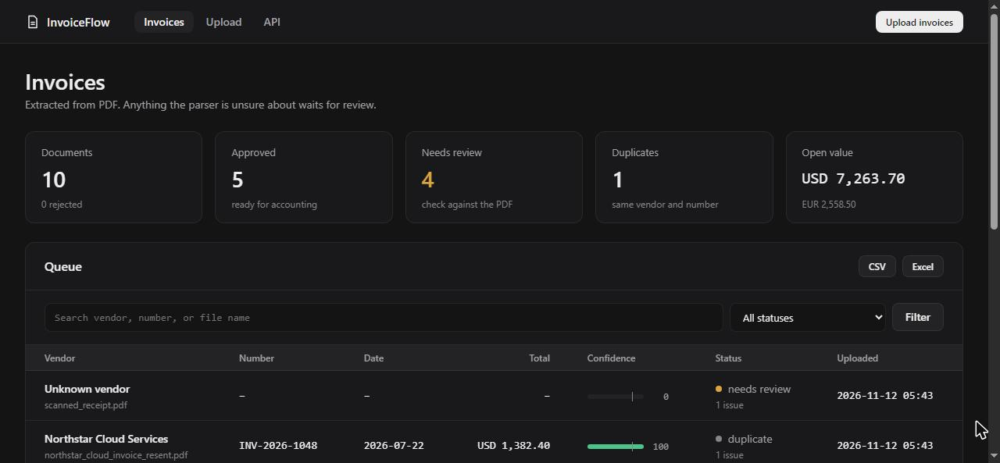
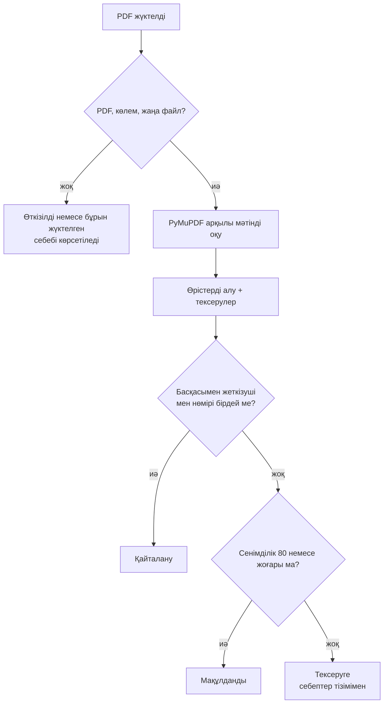
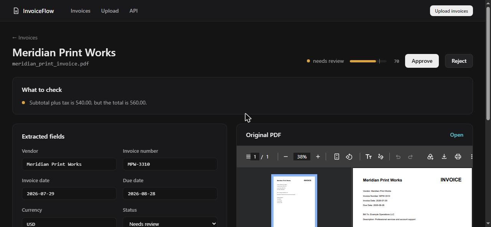
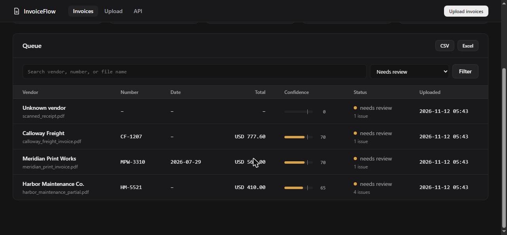

<div align="center">

# 🧾 Invoice Document Automation Dashboard

**PDF шот-фактураларды жүктеңіз, өрістерді алыңыз, ал адам тек парсер сенімсіз өрістерді ғана тексерсін.**

[](https://github.com/artyom129/invoice-document-automation-dashboard/actions/workflows/tests.yml)


**🌐 Тіл:** [English](README.md) · [Русский](README.ru.md) · **Қазақша**



</div>

---

## 📌 Не үшін қажет

Қаржы және операциялық командалар шот-фактураларды әлі де PDF түрінде алады да, жеткізуші атауларын, нөмірлерді, күндерді, салық пен сомаларды кестеге қайта теріп отырады. Теру ұзақ, ал нақты қауіп басқада: ешкім байқамайтын қате сан. Жоба қайталанатын жұмысты өзіне алады және нені оқи алмағанын ашық айтады: жоқ, екіұшты немесе сәйкес келмейтін әр өріс тексерушіге арналған тізімге түседі, ал ол бастапқы PDF-ті алынған мәндердің жанынан көреді.

## ✨ Не істейді

| | Мүмкіндік |
|---|---|
| 📤 | **Пакеттік жүктеу.** Бірден бірнеше PDF жүктеңіз. Әр файл түсінікті нәтиже алады: өңделді, бұрын жүктелген немесе себебімен өткізіп жіберілді |
| 🔍 | **Өрістерді алу.** Жеткізуші, шот нөмірі, шот пен төлем күндері, валюта, салықсыз сома, салық және жиын PDF мәтінінен PyMuPDF арқылы оқылады |
| 🌍 | **Америкалық және еуропалық пішімдер.** `1,234.56`, `1.234,56` және `1 234,56` дұрыс оқылады. Күндер ISO пішіміне келтіріледі (`22.07.2026` → `2026-07-22`) |
| ⚖️ | **Сенуге болатын сенімділік бағасы.** Балды жетіспейтін өрістер, сәйкес келмейтін сомалар, шот күнінен ерте төлем мерзімі және оқылмаған күндер төмендетеді |
| 🛑 | **Үнсіз болжам жоқ.** `03/04/2026` 4 наурыз немесе 3 сәуір болуы мүмкін, сондықтан күн болжанбай, адамға қалдырылады |
| 👀 | **PDF-тің жанында тексеру.** Тексеру беті нені тексеру керектігінің тізімін, өңделетін өрістерді және бастапқы PDF-ті қатар көрсетеді |
| ♊ | **Қайталануларды табу.** Бірдей файлды және бірдей шот нөмірлі бірдей жеткізушіні, регистр мен тыныс белгілерін ескермей табады |
| 🔎 | **Іздеу және сүзгілер.** Жеткізуші, нөмір, файл атауы немесе күй бойынша, беттеп шығарумен |
| 💱 | **Әр валюта бойынша сома.** EUR мен USD ешқашан қосылмайды |
| 📥 | **Экспорт.** CSV және пішімделген Excel, қаласаңыз сүзгімен, мысалы тек мақұлданған шоттар. Кесте формуласына ұқсайтын PDF мәтіні залалсыздандырылады |
| 🔌 | **REST API.** `/api/invoices`, `/api/invoices/{id}`, `/api/stats` және Swagger құжаттамасы |
| 🩺 | **Күйді тексеру, Docker және схеманы автоматты жаңарту** бұрынғы нұсқалар жасаған дерекқорлар үшін |

## 🔄 Шот бойынша шешім қалай шығады



### Сенімділік бағасы

| Өріс | Ұпай | | Тексеру | Айып |
|---|---|---|---|---|
| Шот нөмірі | 20 | | Салықсыз сома мен салықтың қосындысы жиынға тең емес | −30 |
| Жиын | 20 | | Күн басылған, бірақ оқылмайды | −20 |
| Жеткізуші | 15 | | Төлем мерзімі шот күнінен ерте | −10 |
| Шот күні, валюта, салықсыз сома, салық | әрқайсысы 10 | | | |
| Төлем мерзімі | 5 | | | |

Бағасы `AUTO_APPROVE_THRESHOLD` мәнінен (әдепкіде 80) төмен емес шоттар автоматты түрде мақұлданады. Кезектегі шкалада сол деңгейде белгі тұрады.

## 🖼️ Экрандар

| Тексеру | Кезек |
|---|---|
|  |  |

## 🚀 Жылдам бастау

```bash
git clone https://github.com/artyom129/invoice-document-automation-dashboard.git
cd invoice-document-automation-dashboard
python -m venv .venv
```

Ортаны іске қосыңыз:

```bash
# Windows
.venv\Scripts\activate

# macOS / Linux
source .venv/bin/activate
```

Орнатып, іске қосыңыз:

```bash
pip install -r requirements.txt
python seed_demo.py
python run.py
```

Содан кейін ашыңыз:

- Дашборд: http://localhost:8000
- API құжаттамасы (Swagger): http://localhost:8000/docs
- Күйді тексеру: http://localhost:8000/health

`run.py` тек `127.0.0.1` мекенжайын тыңдайды. Басқа құрылғыдан кіру үшін `HOST=0.0.0.0` орнатыңыз, бірақ алдымен қауіпсіздік бөлімін оқыңыз.

### Демо-деректер

`python seed_demo.py` барлық нәтижені қамтитын он шот жасайды: бесеуі мақұлданған (біреуі еуропалық сан пішімімен және күні алдымен тұратын күнмен), біреуінде өрістер жетіспейді, біреуінде сомалар сәйкес келмейді, біреуінде күні екіұшты, біреуі қайталану және бір бетте мәтін жоқ, сканға ұқсас. Скрипт шоттары бар дерекқорға тимейді. Бәрін ауыстыру үшін `python seed_demo.py --reset` іске қосыңыз. Үлгі PDF-тер `sample_invoices/` қалтасына жазылады.

### Docker

```bash
docker compose up --build
docker compose run --rm invoice-dashboard python seed_demo.py --reset   # демо-деректер қалауыңызша
```

## ⚙️ Баптау

Айнымалыларды ортада орнатыңыз (үлгі `.env.example` файлында).

| Айнымалы | Мағынасы | Әдепкі мәні |
|---|---|---|
| `DATABASE_URL` | SQLAlchemy URL | `sqlite:///./data/app.db` |
| `UPLOAD_DIR` | Бастапқы PDF-тер SHA-256 атауымен сақталатын орын | `./data/uploads` |
| `MAX_UPLOAD_MB` | Қабылданатын ең үлкен PDF | `10` |
| `AUTO_APPROVE_THRESHOLD` | Автоматты мақұлдауға қажет сенімділік | `80` |
| `PAGE_SIZE` | Беттегі шоттар саны | `50` |
| `HOST`, `PORT`, `RELOAD` | Тек `run.py` үшін | `127.0.0.1`, `8000`, `1` |

## 🌐 Маршруттар

| Маршрут | Мақсаты |
|---|---|
| `/` | Статистикасы, іздеуі, сүзгілері және беттері бар кезек |
| `/upload` | Әр файл бойынша нәтижесі бар пакеттік жүктеу |
| `/invoices/{id}` | Тексеру беті: ескертулер, өрістер, бастапқы PDF, оқылған мәтін |
| `/invoices/{id}/pdf` | Сақталған PDF |
| `/api/invoices` | JSON тізімі. Сүзгілер: `status`, `q`, `limit`, `offset` |
| `/api/invoices/{id}`, `/api/stats` | Бір шот және дашборд сандары |
| `/export.csv`, `/export.xlsx` | Экспорт. `status` және `q` қабылдайды |
| `/health` | Дерекқорды тексеру (қолжетімсіз болса HTTP 503) |

<details>
<summary>🐛 Осы нұсқада табылып, түзетілген мәселелер</summary>

<br>

- **Тесттер нағыз дерекқорда жұмыс істейтін.** Олар `data/app.db` файлын жұмыс істеп тұрған қосымшамен бөлісетін, сондықтан нәтиже сіздің нені жүктегеніңізге байланысты болатын. Енді әр тесттің өз дерекқоры жадта тұрады.
- **Жүктеу файлдарды үнсіз өткізіп жіберетін немесе құлайтын.** PDF емес файл мен қайталанған файл хабарсыз өткізілетін, ал бұзылған PDF қате бетімен аяқталуы мүмкін еді. Енді әр файл нәтиже мен себеп алады, көлемге шек қойылған.
- **Жалған қайталанулар.** Салыстыру `ILIKE` арқылы жүретін, онда жеткізуші мен нөмір үлгі қызметін атқаратын, сондықтан `_` мен `%` ауыстырғыш таңба болып, әртүрлі шоттар сәйкес келіп қалатын. Регистр мен тыныс белгілеріндегі айырмашылықтар, керісінше, өтіп кететін. Енді салыстыру қалыпқа келтірілген кілт бойынша дәл жүреді.
- **Еуропалық сомалар қате оқылатын.** `2.150,00` `2.15` болып шығатын немесе мүлде табылмайтын, тиынсыз сома еленбейтін, ал `Total (USD): 1,234.50` танылмайтын.
- **Қате жиын автоматты түрде мақұлдануы мүмкін еді.** Сенімділік тек өрістердің бар-жоғын санайтын. Енді сәйкес келмейтін сомалар оны төмендетіп, шотты тексеруге жібереді.
- **Күндер басылған күйінде сақталатын.** `07/22/2026` мен `22.07.2026` салыстырылмайтын, ал екіұшты `03/04/2026` үнсіз қабылданатын. Енді күндер ISO пішімінде, ал екіұштылары белгіленеді.
- **Барлық сомалар доллар белгісімен көрсетіліп, бірге қосылатын.** Енді құн әр валюта бойынша, қайталанулар мен қабылданбаған шоттарсыз есептеледі.
- **Тексеруші бастапқы PDF-ті көрмейтін.** Файлдар кездейсоқ атаумен сақталатын, ол атау еш жерге жазылмайтын. Енді олар хеш бойынша сақталып, өрістердің жанында көрсетіледі.
- **Түзету формасы қате терілгенде сервер қатесін беретін** және кез келген күйді қабылдайтын. Енді ол әр мәселені түсіндіріп, терілгенді сақтайды.
- **Формула енгізу.** PDF-тегі `=HYPERLINK(...)` деп аталатын жеткізуші Excel немесе CSV экспортында жұмыс істейтін формулаға айналатын.
- **Docker бейнесі құрастыру кезінде демо-деректермен толтырылатын**, содан кейін жалғанған том оларды жасыратын. `seed_demo.py` дерекқорды сұрамай өшіретін, ал `run.py` барлық интерфейстерді автоқайта жүктеумен тыңдайтын.
- **Ескі дерекқорлар жаңа `issues_json` бағанында бұзылатын.** Жетіспейтін бағандар енді іске қосылғанда қосылады.

</details>

## 🧪 Тесттер

```bash
python -m pytest
```

110 тест: өрістерді әртүрлі пішімде алу, күндер мен сомаларды талдау, жүктеудің әр нәтижесі, қайталану ережелері, тексеру үдерісі, сүзгілер мен беттер, экспорт және формуладан қорғау, схеманы жаңарту және демо-деректер. Тесттерге арналған PDF-тер бірден жасалады. CI оларды Python 3.11 және 3.12 нұсқаларында іске қосады.

## 📂 Жоба құрылымы

```text
app/
├── main.py          # маршруттар және қосымша фабрикасы
├── extractor.py     # PDF мәтіні, өріс ережелері, күндер, сомалар, сенімділік
├── processing.py    # бір жүктелген файл бір шот жазбасына айналады
├── services.py      # қайталанулар, экспорт
├── models.py        # SQLAlchemy моделі
├── database.py      # қозғалтқыш, сессиялар, схеманы жаңарту
├── config.py        # ортадан алынатын баптаулар
├── templates/       # беттер
└── static/          # CSS және JavaScript
sample_invoices/     # жасалған демо-PDF-тер
seed_demo.py         # демо-деректер
tests/
```

## ⚠️ Шектеулер және қауіпсіздік

- Тек мәтін қабаты бар PDF-тер оқылады. **OCR жоқ**, сондықтан скандар ескертпемен тексеруге түседі. Өріс ережелері `Invoice Number` және `Total` сияқты ағылшын жазбаларына арналған.
- Дашбордта **кіру жүйесі жоқ**. Оны жергілікті түрде немесе аутентификацияның не VPN-нің артында іске қосыңыз.
- Жүктелген PDF-тер дискіде шифрланбай сақталады.
- Нақты қолдану үшін аутентификацияны, OCR-ді және нақты жеткізушілерге арналған үлгілерді қосыңыз.

## 🧰 Технологиялар

Python · FastAPI · SQLAlchemy 2 · SQLite · PyMuPDF · Jinja2 · pandas · openpyxl · ReportLab · pytest · Docker · GitHub Actions

---

<div align="center">

*Авторы: [Artyom Koncha](https://github.com/artyom129). MIT лицензиясы.*

</div>
