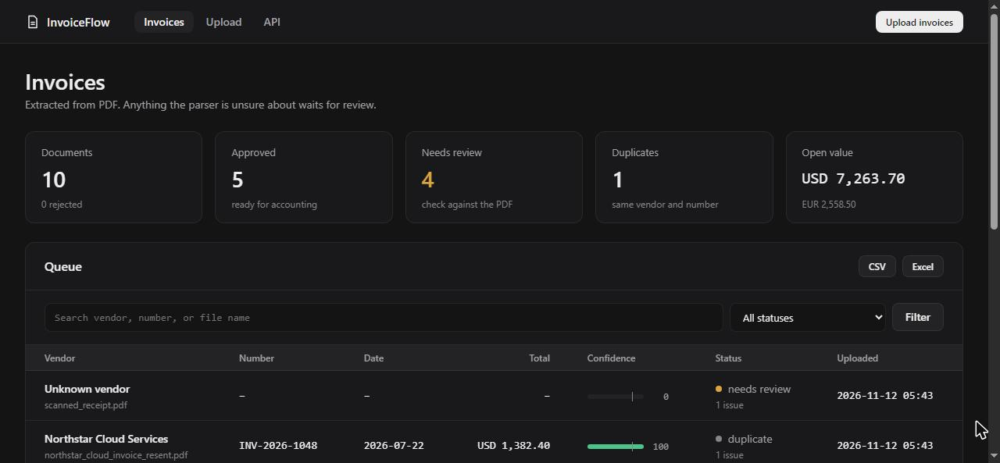
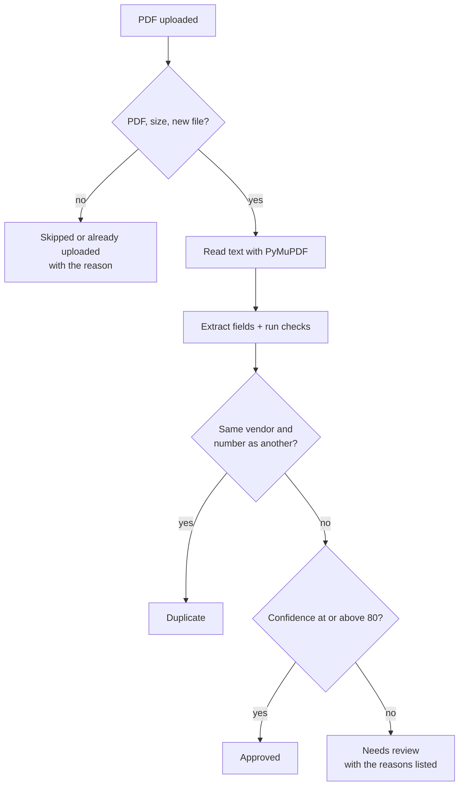
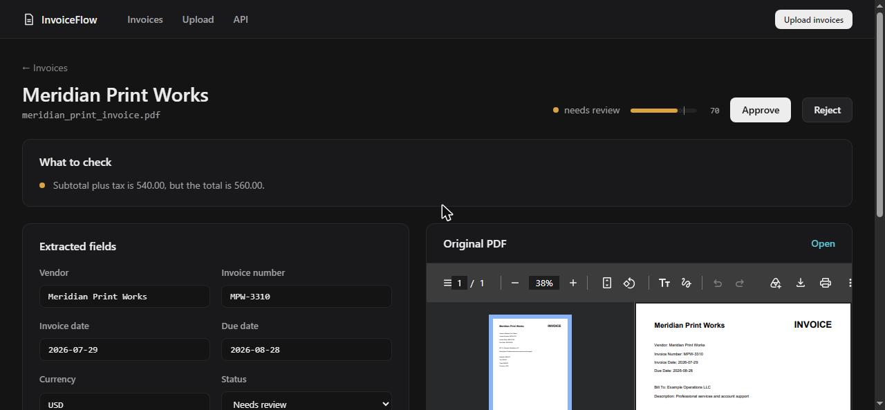
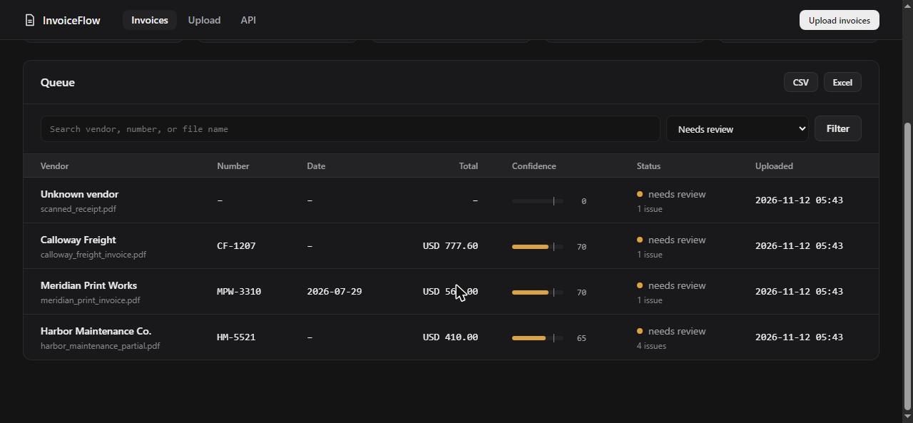

<div align="center">

# 🧾 Invoice Document Automation Dashboard

**Upload PDF invoices, get the fields extracted, and have a person check only the ones the parser is unsure about.**

[](https://github.com/artyom129/invoice-document-automation-dashboard/actions/workflows/tests.yml)


**🌐 Language:** **English** · [Русский](README.ru.md) · [Қазақша](README.kk.md)



</div>

---

## 📌 Why this exists

Finance and operations teams still receive invoices as PDF files and retype vendor names, numbers, dates, tax, and totals into a spreadsheet. The typing is slow, and the real risk is a wrong number that nobody notices. This project does the repetitive part and is honest about what it could not read: every field that is missing, ambiguous, or does not add up is listed for a reviewer, who sees the original PDF right next to the extracted values.

## ✨ What it does

| | Feature |
|---|---|
| 📤 | **Batch upload.** Drop in several PDFs at once. Every file gets a clear outcome: processed, already uploaded, or skipped with the reason |
| 🔍 | **Field extraction.** Vendor, invoice number, invoice and due dates, currency, subtotal, tax, and total, read from the PDF text with PyMuPDF |
| 🌍 | **US and European formats.** `1,234.56`, `1.234,56`, and `1 234,56` all read correctly. Dates become ISO (`22.07.2026` → `2026-07-22`) |
| ⚖️ | **Confidence you can trust.** Missing fields lower the score, and so do totals that do not add up, a due date before the invoice date, and dates that cannot be read |
| 🛑 | **No silent guesses.** `03/04/2026` could be March 4 or April 3, so it is left for a person instead of being guessed |
| 👀 | **Review beside the PDF.** The review page shows a list of what to check, editable fields, and the original PDF side by side |
| ♊ | **Duplicate detection.** Catches the same file and the same vendor with the same invoice number, ignoring case and punctuation |
| 🔎 | **Search and filters.** By vendor, number, file name, or status, with pagination |
| 💱 | **Value per currency.** EUR and USD are never added together |
| 📥 | **Exports.** CSV and formatted Excel, optionally filtered, for example approved invoices only. Text from PDFs that looks like a spreadsheet formula is neutralized |
| 🔌 | **REST API.** `/api/invoices`, `/api/invoices/{id}`, `/api/stats`, with Swagger docs |
| 🩺 | **Health check, Docker, and automatic schema updates** for databases created by older versions |

## 🔄 How an invoice is decided



### Confidence score

| Field | Points | | Check | Penalty |
|---|---|---|---|---|
| Invoice number | 20 | | Subtotal plus tax is not the total | −30 |
| Total | 20 | | A date is printed but cannot be read | −20 |
| Vendor | 15 | | Due date is before the invoice date | −10 |
| Invoice date, currency, subtotal, tax | 10 each | | | |
| Due date | 5 | | | |

Invoices at or above `AUTO_APPROVE_THRESHOLD` (80 by default) are approved automatically. The meter in the queue has a tick at that line.

## 🖼️ Screens

| Review | Queue |
|---|---|
|  |  |

## 🚀 Quick start

```bash
git clone https://github.com/artyom129/invoice-document-automation-dashboard.git
cd invoice-document-automation-dashboard
python -m venv .venv
```

Activate the environment:

```bash
# Windows
.venv\Scripts\activate

# macOS / Linux
source .venv/bin/activate
```

Install and start:

```bash
pip install -r requirements.txt
python seed_demo.py
python run.py
```

Then open:

- Dashboard: http://localhost:8000
- API docs (Swagger): http://localhost:8000/docs
- Health check: http://localhost:8000/health

`run.py` listens on `127.0.0.1` only. To reach it from another device set `HOST=0.0.0.0` and read the security notes first.

### Demo data

`python seed_demo.py` creates ten invoices that cover every outcome: five approved (one with a European number format and a day-first date), one with missing fields, one whose totals do not add up, one with an ambiguous date, one duplicate, and one page with no text, like a scan. The script refuses to touch a database that already has invoices. Use `python seed_demo.py --reset` to replace everything. The sample PDFs are written to `sample_invoices/`.

### Docker

```bash
docker compose up --build
docker compose run --rm invoice-dashboard python seed_demo.py --reset   # optional demo data
```

## ⚙️ Configuration

Set these in the environment (a template is in `.env.example`).

| Variable | Meaning | Default |
|---|---|---|
| `DATABASE_URL` | SQLAlchemy URL | `sqlite:///./data/app.db` |
| `UPLOAD_DIR` | Where original PDFs are kept, named by their SHA-256 | `./data/uploads` |
| `MAX_UPLOAD_MB` | Largest accepted PDF | `10` |
| `AUTO_APPROVE_THRESHOLD` | Confidence needed for automatic approval | `80` |
| `PAGE_SIZE` | Invoices per page | `50` |
| `HOST`, `PORT`, `RELOAD` | Used by `run.py` only | `127.0.0.1`, `8000`, `1` |

## 🌐 Routes

| Route | Purpose |
|---|---|
| `/` | Queue with stats, search, filters, and pagination |
| `/upload` | Batch upload with a per-file result |
| `/invoices/{id}` | Review page: issues, fields, original PDF, parsed text |
| `/invoices/{id}/pdf` | The stored PDF |
| `/api/invoices` | JSON list. Filters: `status`, `q`, `limit`, `offset` |
| `/api/invoices/{id}`, `/api/stats` | One invoice, and the dashboard numbers |
| `/export.csv`, `/export.xlsx` | Exports. Accept `status` and `q` |
| `/health` | Database check (HTTP 503 if unreachable) |

<details>
<summary>🐛 Problems found and fixed in this version</summary>

<br>

- **The tests ran against the real database.** They shared `data/app.db` with the running app, so results depended on what you had uploaded. Each test now gets an in-memory database.
- **Uploads failed silently or crashed.** A non-PDF or a repeated file was skipped with no message, and a damaged PDF could end in an error page. Every file now gets a result and a reason, and there is a size limit.
- **False duplicates.** The match used `ILIKE` with the vendor and number as the pattern, so `_` and `%` acted as wildcards and different invoices matched. Case and punctuation differences were missed. The match is now exact on a normalized key.
- **European amounts were misread.** `2.150,00` came out as `2.15` or not at all, an amount without cents was ignored, and `Total (USD): 1,234.50` was not recognized.
- **A wrong total could be approved automatically.** Confidence only counted which fields were present. Totals that do not add up now lower it and send the invoice to review.
- **Dates were stored as typed.** `07/22/2026` and `22.07.2026` could not be compared, and an ambiguous `03/04/2026` was accepted without a word. Dates are now ISO, and ambiguous ones are flagged.
- **All amounts were shown with a dollar sign and added together.** Value is now summed per currency, without duplicates and rejected invoices.
- **The reviewer could not see the original PDF.** Files were stored under random names that were never linked to the record. They are now stored by hash and shown next to the fields.
- **The edit form returned a server error on a typo** and accepted any status. It now explains each problem and keeps what you typed.
- **Formula injection.** A vendor named `=HYPERLINK(...)` in a PDF became a live formula in the Excel or CSV export.
- **The Docker image seeded demo data at build time**, which the mounted volume then hid. `seed_demo.py` erased the database without asking, and `run.py` listened on every interface with auto-reload on.
- **Older databases broke on the new `issues_json` column.** Missing columns are now added on start.

</details>

## 🧪 Tests

```bash
python -m pytest
```

110 tests: field extraction in many formats, date and amount parsing, every upload outcome, duplicate rules, the review workflow, filters and pagination, exports and formula protection, the schema upgrade, and the demo data. PDFs for the tests are generated on the fly. CI runs them on Python 3.11 and 3.12.

## 📂 Project structure

```text
app/
├── main.py          # routes and application factory
├── extractor.py     # PDF text, field rules, dates, amounts, confidence
├── processing.py    # one uploaded file to one invoice record
├── services.py      # duplicates, exports
├── models.py        # SQLAlchemy model
├── database.py      # engine, sessions, schema upgrade
├── config.py        # environment settings
├── templates/       # pages
└── static/          # CSS and JavaScript
sample_invoices/     # generated demo PDFs
seed_demo.py         # demo data
tests/
```

## ⚠️ Limits and security

- Only PDFs with a text layer are read. **There is no OCR**, so scans go to review with a note. Field rules expect English labels such as `Invoice Number` and `Total`.
- The dashboard has **no login**. Run it locally or behind authentication or a VPN.
- Uploaded PDFs are stored unencrypted on disk.
- For real use add authentication, OCR, and vendor-specific templates.

## 🧰 Tech stack

Python · FastAPI · SQLAlchemy 2 · SQLite · PyMuPDF · Jinja2 · pandas · openpyxl · ReportLab · pytest · Docker · GitHub Actions

---

<div align="center">

*Developed by [Artyom Koncha](https://github.com/artyom129). MIT license.*

</div>
