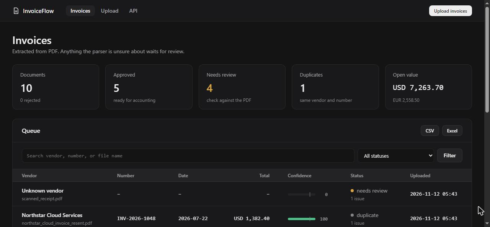
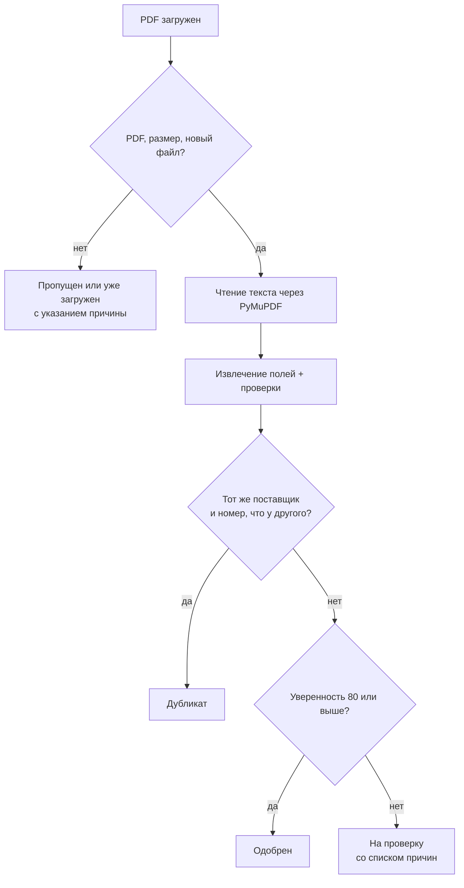
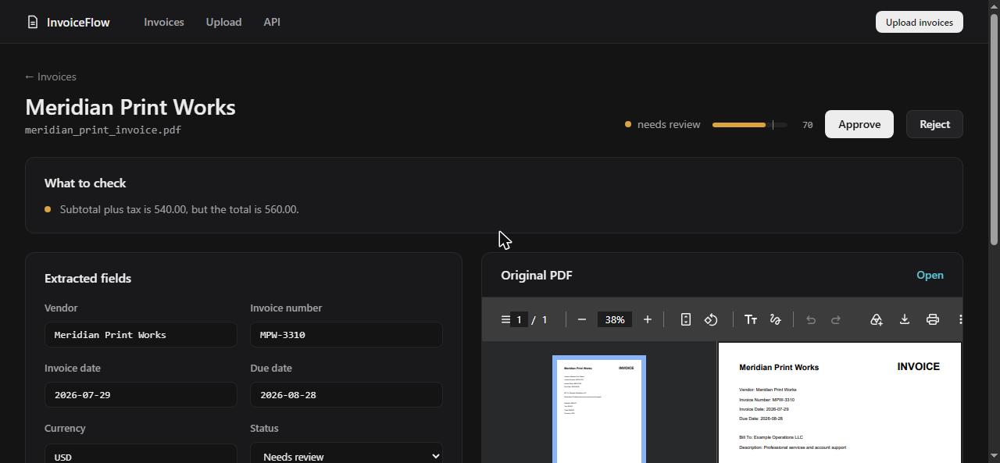
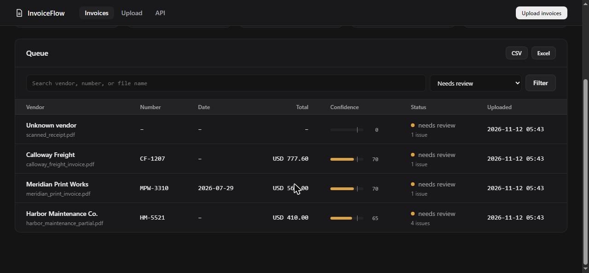

<div align="center">

# 🧾 Invoice Document Automation Dashboard

**Загрузите PDF-счета, получите извлечённые поля, а человек проверит только те, в которых парсер не уверен.**

[](https://github.com/artyom129/invoice-document-automation-dashboard/actions/workflows/tests.yml)


**🌐 Язык:** [English](README.md) · **Русский** · [Қазақша](README.kk.md)



</div>

---

## 📌 Зачем это нужно

Финансовые и операционные команды до сих пор получают счета в виде PDF и перепечатывают названия поставщиков, номера, даты, налог и суммы в таблицу. Печатать долго, а настоящий риск в другом: неверная цифра, которую никто не заметит. Проект берёт на себя рутину и честно говорит, чего не смог прочитать: каждое поле, которого нет, которое неоднозначно или не сходится, попадает в список для проверяющего, а исходный PDF он видит рядом с извлечёнными значениями.

## ✨ Что он делает

| | Возможность |
|---|---|
| 📤 | **Пакетная загрузка.** Загружайте сразу несколько PDF. Каждый файл получает понятный результат: обработан, уже загружен или пропущен с причиной |
| 🔍 | **Извлечение полей.** Поставщик, номер счёта, даты счёта и оплаты, валюта, сумма без налога, налог и итог читаются из текста PDF через PyMuPDF |
| 🌍 | **Американский и европейский форматы.** `1,234.56`, `1.234,56` и `1 234,56` читаются правильно. Даты приводятся к ISO (`22.07.2026` → `2026-07-22`) |
| ⚖️ | **Оценка уверенности, которой можно доверять.** Балл снижают недостающие поля, а также суммы, которые не сходятся, срок оплаты раньше даты счёта и даты, которые не удалось прочитать |
| 🛑 | **Никаких молчаливых догадок.** `03/04/2026` может быть 4 марта или 3 апреля, поэтому дата остаётся человеку, а не угадывается |
| 👀 | **Проверка рядом с PDF.** Страница проверки показывает список того, что стоит проверить, редактируемые поля и исходный PDF рядом |
| ♊ | **Поиск дубликатов.** Находит тот же файл и того же поставщика с тем же номером счёта, не обращая внимания на регистр и знаки препинания |
| 🔎 | **Поиск и фильтры.** По поставщику, номеру, имени файла или статусу, с постраничным выводом |
| 💱 | **Сумма по каждой валюте.** EUR и USD никогда не складываются вместе |
| 📥 | **Экспорт.** CSV и отформатированный Excel, при желании с фильтром, например только одобренные счета. Текст из PDF, похожий на формулу таблицы, обезвреживается |
| 🔌 | **REST API.** `/api/invoices`, `/api/invoices/{id}`, `/api/stats` и документация Swagger |
| 🩺 | **Проверка состояния, Docker и автоматическое обновление схемы** для баз, созданных прежними версиями |

## 🔄 Как принимается решение по счёту



### Оценка уверенности

| Поле | Баллы | | Проверка | Штраф |
|---|---|---|---|---|
| Номер счёта | 20 | | Сумма без налога плюс налог не равна итогу | −30 |
| Итог | 20 | | Дата напечатана, но не читается | −20 |
| Поставщик | 15 | | Срок оплаты раньше даты счёта | −10 |
| Дата счёта, валюта, сумма без налога, налог | по 10 | | | |
| Срок оплаты | 5 | | | |

Счета с оценкой не ниже `AUTO_APPROVE_THRESHOLD` (по умолчанию 80) одобряются автоматически. На шкале в очереди на этом уровне стоит засечка.

## 🖼️ Экраны

| Проверка | Очередь |
|---|---|
|  |  |

## 🚀 Быстрый старт

```bash
git clone https://github.com/artyom129/invoice-document-automation-dashboard.git
cd invoice-document-automation-dashboard
python -m venv .venv
```

Активируйте окружение:

```bash
# Windows
.venv\Scripts\activate

# macOS / Linux
source .venv/bin/activate
```

Установите зависимости и запустите:

```bash
pip install -r requirements.txt
python seed_demo.py
python run.py
```

Затем откройте:

- Дашборд: http://localhost:8000
- Документация API (Swagger): http://localhost:8000/docs
- Проверка состояния: http://localhost:8000/health

`run.py` слушает только `127.0.0.1`. Чтобы открыть доступ с другого устройства, задайте `HOST=0.0.0.0`, но сначала прочитайте раздел о безопасности.

### Демо-данные

`python seed_demo.py` создаёт десять счетов, которые покрывают все исходы: пять одобренных (один с европейским форматом чисел и датой, где день стоит первым), один с недостающими полями, один с несходящимися суммами, один с неоднозначной датой, один дубликат и одна страница без текста, как у скана. Скрипт отказывается менять базу, в которой уже есть счета. Чтобы заменить всё, запустите `python seed_demo.py --reset`. Примеры PDF записываются в `sample_invoices/`.

### Docker

```bash
docker compose up --build
docker compose run --rm invoice-dashboard python seed_demo.py --reset   # демо-данные по желанию
```

## ⚙️ Настройка

Задавайте переменные в окружении (шаблон лежит в `.env.example`).

| Переменная | Значение | По умолчанию |
|---|---|---|
| `DATABASE_URL` | URL SQLAlchemy | `sqlite:///./data/app.db` |
| `UPLOAD_DIR` | Где хранятся исходные PDF, под именем из SHA-256 | `./data/uploads` |
| `MAX_UPLOAD_MB` | Наибольший принимаемый PDF | `10` |
| `AUTO_APPROVE_THRESHOLD` | Уверенность для автоматического одобрения | `80` |
| `PAGE_SIZE` | Счетов на странице | `50` |
| `HOST`, `PORT`, `RELOAD` | Только для `run.py` | `127.0.0.1`, `8000`, `1` |

## 🌐 Маршруты

| Маршрут | Назначение |
|---|---|
| `/` | Очередь со статистикой, поиском, фильтрами и страницами |
| `/upload` | Пакетная загрузка с результатом по каждому файлу |
| `/invoices/{id}` | Страница проверки: замечания, поля, исходный PDF, прочитанный текст |
| `/invoices/{id}/pdf` | Сохранённый PDF |
| `/api/invoices` | Список в JSON. Фильтры: `status`, `q`, `limit`, `offset` |
| `/api/invoices/{id}`, `/api/stats` | Один счёт и числа дашборда |
| `/export.csv`, `/export.xlsx` | Экспорт. Принимают `status` и `q` |
| `/health` | Проверка базы данных (HTTP 503, если она недоступна) |

<details>
<summary>🐛 Проблемы, найденные и исправленные в этой версии</summary>

<br>

- **Тесты работали на настоящей базе.** Они делили `data/app.db` с запущенным приложением, поэтому результат зависел от того, что вы загрузили. Теперь у каждого теста своя база в памяти.
- **Загрузка молча пропускала файлы или падала.** Не PDF и повторный файл пропускались без сообщения, а повреждённый PDF мог закончиться страницей ошибки. Теперь каждый файл получает результат и причину, а размер ограничен.
- **Ложные дубликаты.** Сравнение шло через `ILIKE`, где поставщик и номер служили шаблоном, поэтому `_` и `%` работали как подстановочные знаки и разные счета совпадали. Различия в регистре и знаках препинания, наоборот, пропускались. Теперь сравнение точное по нормализованному ключу.
- **Европейские суммы читались неверно.** `2.150,00` превращалось в `2.15` или не находилось вовсе, сумма без копеек игнорировалась, а `Total (USD): 1,234.50` не распознавалось.
- **Неверный итог мог быть одобрен автоматически.** Уверенность учитывала только наличие полей. Теперь несходящиеся суммы снижают её и отправляют счёт на проверку.
- **Даты хранились как напечатаны.** `07/22/2026` и `22.07.2026` нельзя было сравнить, а неоднозначная `03/04/2026` принималась молча. Теперь даты в формате ISO, а неоднозначные помечаются.
- **Все суммы показывались со знаком доллара и складывались вместе.** Теперь стоимость считается по каждой валюте, без дубликатов и отклонённых счетов.
- **Проверяющий не видел исходный PDF.** Файлы хранились под случайными именами, которые нигде не записывались. Теперь они хранятся по хешу и показываются рядом с полями.
- **Форма правки возвращала ошибку сервера при опечатке** и принимала любой статус. Теперь она объясняет каждую проблему и сохраняет введённое.
- **Инъекция формул.** Поставщик с названием `=HYPERLINK(...)` в PDF становился рабочей формулой в выгрузке Excel или CSV.
- **Образ Docker заполнялся демо-данными при сборке**, а подключённый том их затем скрывал. `seed_demo.py` стирал базу без вопросов, а `run.py` слушал все интерфейсы с автоперезагрузкой.
- **Старые базы ломались на новой колонке `issues_json`.** Недостающие колонки теперь добавляются при запуске.

</details>

## 🧪 Тесты

```bash
python -m pytest
```

110 тестов: извлечение полей в разных форматах, разбор дат и сумм, каждый исход загрузки, правила дубликатов, процесс проверки, фильтры и страницы, экспорт и защита от формул, обновление схемы и демо-данные. PDF для тестов создаются на лету. CI запускает их на Python 3.11 и 3.12.

## 📂 Структура проекта

```text
app/
├── main.py          # маршруты и фабрика приложения
├── extractor.py     # текст PDF, правила полей, даты, суммы, уверенность
├── processing.py    # один загруженный файл в одну запись о счёте
├── services.py      # дубликаты, экспорт
├── models.py        # модель SQLAlchemy
├── database.py      # движок, сессии, обновление схемы
├── config.py        # настройки из окружения
├── templates/       # страницы
└── static/          # CSS и JavaScript
sample_invoices/     # созданные демо-PDF
seed_demo.py         # демо-данные
tests/
```

## ⚠️ Ограничения и безопасность

- Читаются только PDF с текстовым слоем. **OCR нет**, поэтому сканы попадают на проверку с пометкой. Правила полей рассчитаны на английские подписи вроде `Invoice Number` и `Total`.
- У дашборда **нет входа по паролю**. Запускайте его локально или за аутентификацией либо VPN.
- Загруженные PDF хранятся на диске без шифрования.
- Для реального использования добавьте аутентификацию, OCR и шаблоны под конкретных поставщиков.

## 🧰 Технологии

Python · FastAPI · SQLAlchemy 2 · SQLite · PyMuPDF · Jinja2 · pandas · openpyxl · ReportLab · pytest · Docker · GitHub Actions

---

<div align="center">

*Автор: [Artyom Koncha](https://github.com/artyom129). Лицензия MIT.*

</div>
